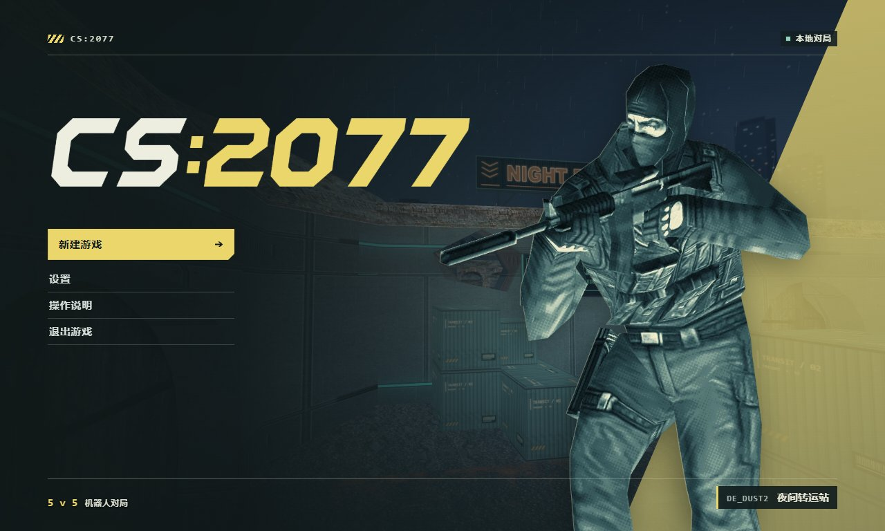
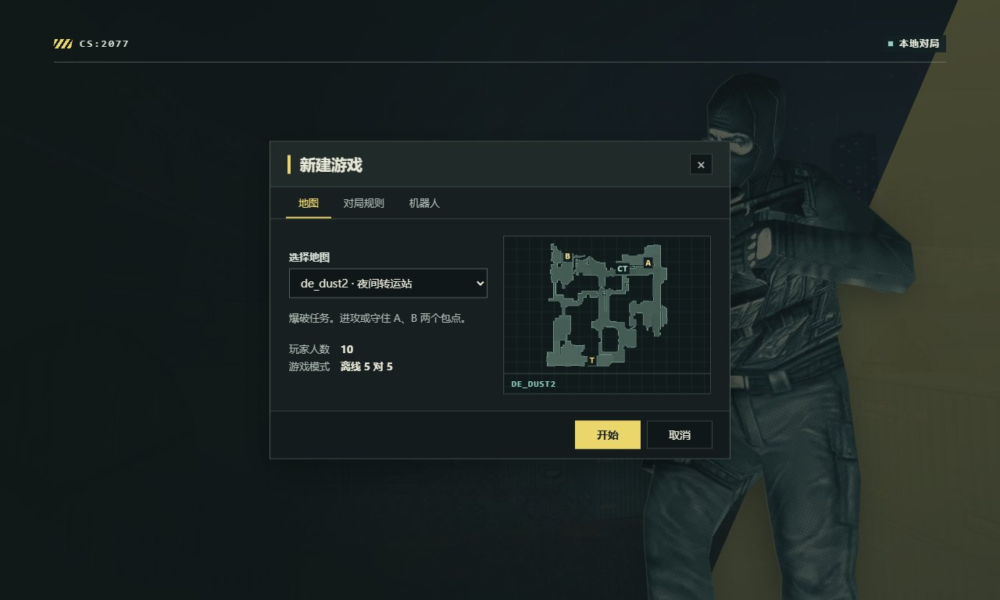
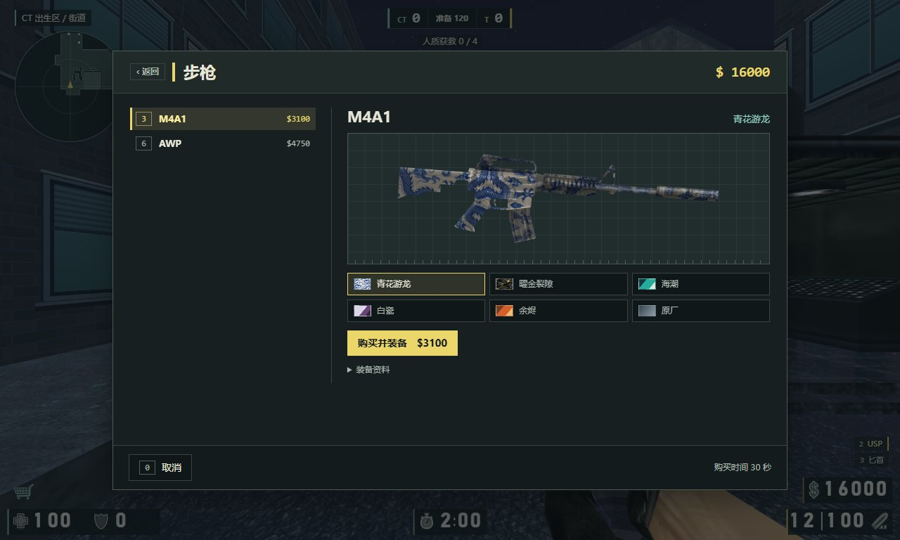
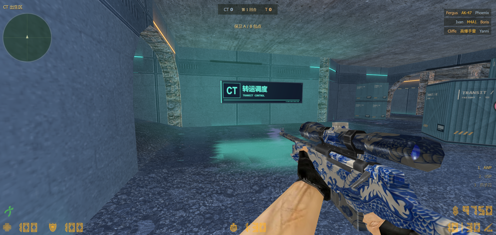

# CS:2077

**v1.0 · 中文 · 单文件离线 5 对 5**

2077 将在雨夜的赛博港区重温经典 Counter-Strike 的爆破与人质营救行动。你扮演一名 T 或 CT，与四名机器人队友对阵五名对手，先赢下 16 回合的一方取得比赛胜利。

[在线试玩 CS:2077](https://cs2077.must-xin.com/)



## 开始游戏

1. 下载 [v1.0 单文件游戏](https://github.com/THU-HX/CS2077/releases/download/v1.0/CS2077.html)，保存为 `CS2077.html`。也可以打开 [仓库中的 HTML](CS2077.html)，使用 GitHub 的 **Download raw file**。
2. 用桌面版 Chrome 或 Edge 打开文件。浏览器需要支持 WebGL 2，并启用硬件加速。地图、模型、纹理、音效和 Three.js 都已内嵌，下载后可断网游玩。
3. 点击「新建游戏」选地图，在「对局规则」选阵营和初始资金，在「机器人」选难度。第一次体验可用默认的 $16000 熟悉装备，也可以选 $800 开始经典经济局。

| 地图 | 任务 |
| --- | --- |
| **夜间转运站** · `de_dust2` | T 方携带 C4 进攻 A 或 B 区。到达包点后切到 5 号位，站定并按住左键 3 秒安放。CT 守点，或靠近已安放的 C4 按住 E 拆除。 |
| **机修总厂** · `cs_assault` | CT 进入仓库，在人质附近按 E 切换跟随或等待，将人质带回出生营救区。T 方防守仓库。 |



## 键鼠操作

使用 Chrome 或 Edge 时，选择「新建游戏 → 全屏开始」，若浏览器询问键盘锁定权限，可以允许。对局中可按住 Ctrl 蹲伏，再按 E 交互或 W 前进；Esc 暂停，打开采购菜单也会释放键盘锁定。选择「窗口开始」或浏览器未授予键盘锁定时，按住 C 也能蹲伏并配合 E。网页发起的全屏支持锁定游戏键，操作系统保留的快捷键仍由系统处理。[Chrome 键盘锁定说明](https://developer.chrome.com/docs/capabilities/web-apis/keyboard-lock)

| 操作 | 按键 |
| --- | --- |
| 移动、静步、蹲伏、跳跃 | W / A / S / D，Shift，Ctrl 或 C，空格 |
| 转向、开火、换弹 | 移动鼠标，左键，R。若鼠标未锁定，可按住左键拖动转向。 |
| 副攻击 | 右键。随装备切换瞄准镜、消音器、Glock 模式或近战重击。 |
| 切换装备 | 1 主武器、2 副武器、3 近战、4 手雷、5 C4，也可滚动滚轮 |
| 投掷手雷 | 按 4 切出，按住左键调整视角并蓄力，松开时沿当前瞄准方向投出。短按近投，约 1 秒蓄满；继续按住可以保持瞄准。 |
| 购买、使用、丢弃 | B 打开采购，E 交互，G 丢下当前枪械或 C4 |
| 比分、暂停、性能统计 | 按住 Tab，Esc，F3 |
| 阵亡后观战 | 左键或空格切到下一名队友，右键切到上一名 |

## 采购与战斗反馈

在出生购买区按 **B**。六把枪包括 AK-47、M4A1、AWP、USP、Glock 18 和 Desert Eagle，主战步枪按阵营供应。装备页提供高爆手雷、护甲和 CT 拆弹器。采购支持数字键，A 自动购买，R 重购上次装备。

- **涂装**：枪械可选海潮、白瓷、余烬、原厂，以及从设计稿选出的青花游龙、曜金裂隙。近战和高爆手雷另外提供离子光谱、黄蜂警戒。确认购买前可以看模型预览，已持有的装备支持免费换装。
- **近战**：匕首、蝴蝶刀和爪子刀可在购买区免费装备。蝴蝶刀切出时刀身与活动柄分别翻开，爪子刀绕指环旋转。 [切换动作实录](docs/screenshots/melee-draw.gif)
- **手雷**：切换武器或暂停可取消蓄力并保留手雷。引信从手雷离手时开始计时。
- **命中**：白色四线标记表示命中，头部命中为青色，击杀时准星变红。屏幕下方的翼盾、机械颅面、交叉刀刃和破片手雷分别对应普通、爆头、近战和手雷击杀。 [高爆手雷双杀实录](docs/screenshots/he-double-kill.gif)





## 源码与依赖

**后续开发以仓库根目录的 `CS2077.html` 为准。** 每次修改单文件后，用 Node.js 在仓库根目录执行以下命令。导出工具只使用 Node 标准库，已在 Node.js 22 验证。

```sh
node scripts/sync-source.mjs
node scripts/sync-source.mjs --check
```

第一条命令从当前游戏导出源码和依赖，第二条逐项校验内容。手工编辑的设计原稿和运行截图由各自目录管理。

| 路径 | 用途 |
| --- | --- |
| [CS2077.html](CS2077.html) | 权威开发入口，也是可独立分发的离线游戏 |
| [src/index.html](src/index.html)、[game.js](src/game.js)、[ui.css](src/ui.css) | 导出的浏览器入口、游戏逻辑、着色器和界面代码 |
| [src/embedded-assets.js](src/embedded-assets.js)、[src/assets/](src/assets/) | 内嵌地图、模型、音频、HUD 数据及运行时使用的美术贴图 |
| [src/design/](src/design/README.md) | 涂装选稿、地形、击杀徽章、爆炸图集和封面来源 |
| [vendor/three-0.160.1/](vendor/three-0.160.1/) | 由游戏内嵌包导出的 Three.js r160 浏览器构建与 MIT 许可 |
| [docs/screenshots/](docs/screenshots/) | 离线浏览器中的游戏截图和动作实录 |

若要调试拆分版，可从仓库根目录运行 `python -m http.server 8000 --bind 127.0.0.1`，用浏览器访问 `http://127.0.0.1:8000/src/`。游戏还使用浏览器内置的 Canvas 2D、Web Audio、DecompressionStream 和 localStorage。

## 开发、贡献与版权联系

本项目源自经典 Counter-Strike。由维护者 **THU-HX** 确定玩法、视觉方向、涂装选稿与版本，使用 **Claude** 和 **ChatGPT（Codex）** 联合开发。开发期间由 AI 协助搜集、整理公开网络资料，制作美术候选稿，并协助实现和测试浏览器版本。

感谢 Counter-Strike 原作者 **Minh “Gooseman” Le**、**Jess Cliffe**，以及 Valve 和参与经典地图、纹理、模型与声音制作的作者。Dust II 的原地图说明署名 **DaveJ（Dave Johnston）**，纹理署名 **MacMan**。本版 Assault 地图数据保留了 **CryptR** 的署名。夜间港区与脉冲效果参考了 **Felix Rieseberg** 署名合集中的 *Saltline*；网页 3D 渲染使用 **Three.js Authors** 的 Three.js。具体出处见[来源与第三方声明](THIRD_PARTY_NOTICES.md)。

如果你是某项素材的原作者或权利人，发现漏署名、误署名或有使用方面的异议，请通过 [GitHub Issues 联系维护者](https://github.com/THU-HX/CS2077/issues/new)，附素材名称、游戏中的位置和可核对的原始链接。我会核实来源，补充作者与贡献记录，并按情况更正、替换或移除相关内容。

